

  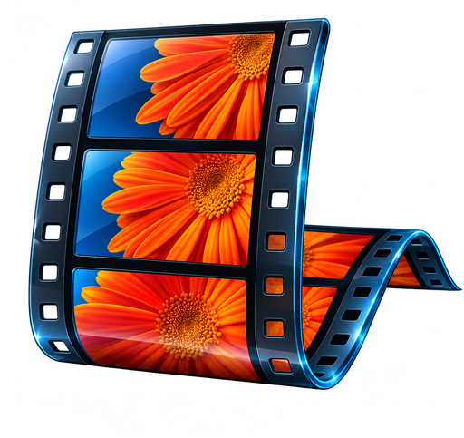

<h1 align="center">Gerbera Studio</h1>

  <b>A free, beginner-friendly movie editor for Windows: the storyboard simplicity you remember, rebuilt for 4K and modern formats.</b>

  <a href="../../releases/latest"><b>⬇ Download the latest installer</b></a> ·
  <a href="#getting-started">Getting started</a> ·
  <a href="#features">Features</a> ·
  <a href="#building-from-source">Build from source</a>

  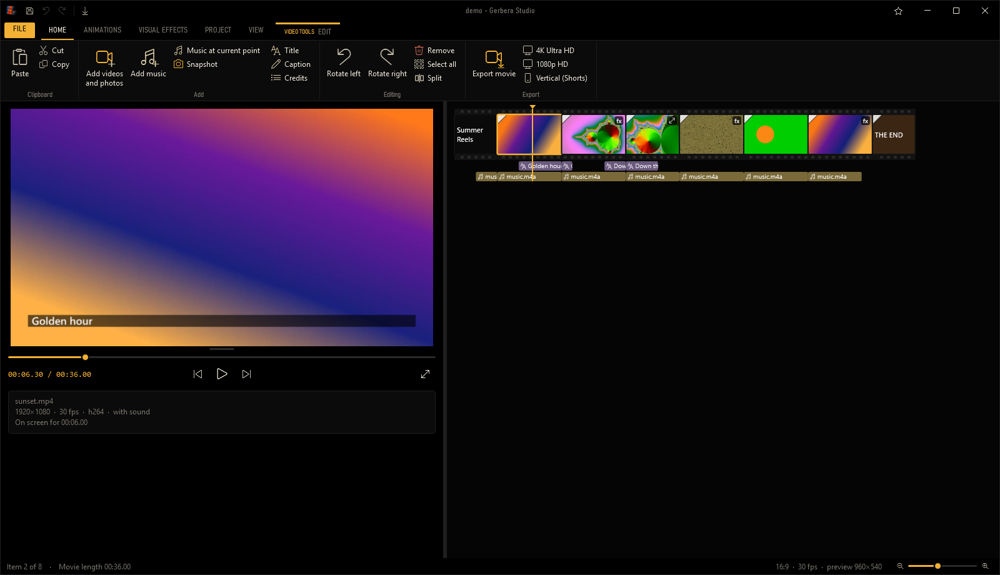

---

## Why I made this

I grew up making videos in Windows Movie Maker, starting on Windows XP and moving through the versions that followed, all the way to Windows Live Movie Maker. It was where I learned what a cut, a transition and a title card were. You dragged in your clips, they lined up on a storyboard, you picked a transition from a gallery, added some music, and you had a movie. No timelines with forty tracks, no subscriptions, no learning curve.

When Microsoft retired it, nothing really replaced it. Today's free editors are either too limited, stuffed with watermarks and upsells, or built for professionals and overwhelming for someone who just wants to make something.

So I built the editor I always wished existed: **the same easy, storyboard-first workflow, but modern.** It handles 4K and high frame rates, opens nearly any file you throw at it, exports to today's formats, and comes packed with effects, green screen, voice effects, and a lot more. It's for YouTubers, film makers, students, families, and anyone who wants to make a video without fighting their software.

**This is a passion project.** It's free, and it'll stay free.

---

## Features

### The classic workflow
- **Storyboard editing:** clips sit side by side as filmstrip tiles that wrap like a page, with the length of each tile showing how long it plays. Drag to reorder, and drop files straight from File Explorer.
- **Ribbon interface** with Home, Animations, Visual Effects, Project and View tabs, plus pop-up **Edit**, **Music** and **Text** tools when you select something.
- **Live preview** that resizes to fit your project's shape, with frame-by-frame stepping and a full-screen mode.
- **Music and caption bars** under each clip, which you can drag to line up perfectly.
- **Undo/redo**, cut/copy/paste, split, trim (set start and end points), rotate, and "Fit to music".

### Modern formats and output
- **Opens almost anything:** MP4, MOV, MKV, WebM, AVI, MTS and more; HEVC, AV1 and ProRes video; HEIC, AVIF, WebP and RAW-style photos; MP3, FLAC, WAV, Opus and other audio.
- **Exports up to 8K**, with one-click presets for **4K Ultra HD**, 1080p, **vertical video** for Shorts, Reels and TikTok, square, web, an editing master and a lossless archive.
- **Video formats:** H.264, H.265/HEVC, AV1, VP9, Apple ProRes 422 HQ and FFV1 lossless, with **10-bit color**.
- **GPU-accelerated exporting** on NVIDIA, Intel and AMD graphics cards when available.
- **Advanced frame rates:** 23.976 up to 240 fps, plus custom rates. There are three conversion modes: drop/duplicate, frame blending, and **motion interpolation** for buttery-smooth slow motion.
- **Aspect ratios:** 16:9, 4:3, 9:16 vertical, 1:1 square and 21:9 cinema.

### Effects
| Nostalgic | Modern | Stylized |
|---|---|---|
| **Film noir** (deep blacks, grain, heavy vignette) | Cinematic | Negative |
| **Silent film 1:1** (square frame, B&W, flicker, scratches, dust) | Dreamy glow | Posterize |
| **Sepia western** (warm dust, dark scratches, grain) | Chromatic aberration | Threshold |
| Old film | Glitch | Pixelate |
| Black & white / B&W red filter | Duotone | Blur / soft focus |
| Sepia / cyan tone | Cross process | Edge darken |
| VHS tape | Vivid / faded matte / warm / cool / sharpen | Night vision / mirror / film grain |

Plus brightness, contrast and saturation sliders, **25 transitions**, and pan and zoom for photos and video.

### Green screen
Remove green, blue or any color behind your subject, with tolerance, softness and spill removal. Put a **photo, a video or a solid color** behind them.

### Reverse
Play any clip **backwards**, picture and sound together.

### Audio effects
- **Voice and sound:** deep voice, high voice, robot, echo, big hall, telephone, radio, megaphone, underwater, lo-fi.
- **Themed degradation:** 1940s noir microphone, silent-era projector, dusty gramophone, VHS tape.
- **Match visual effect:** one click pairs the sound with the look, for example noir video with a 1940s mic. You can also mix and match them separately.
- Volume, fade in/out, and an audio mix slider that balances video sound against music.

### Titles and captions
- **Style presets:** Classic, Clean, Kinetic, Lower third, Neon, Glitch, **Silent film card** (with an ornate frame), **Film noir**, **Western poster**, Typewriter.
- **Animations:** fade, fly in, zoom, pop, typewriter, scrolling credits, cinematic zoom, wipe reveal, stamp, glitch, projector flicker.
- Any installed font, plus outline, shadow, **glow**, background box or full-width bar, alignment and opacity.

### Gerbera Labs
Click the beaker in the **File** menu for experimental and just-for-fun extras. The first one is a **nostalgic loading screen**: an airy glass splash with soft beams of light and a glowing progress bar that matches your theme (starry night, amber sunset or bright clouds), for that classic "installing something in 2009" feeling. It's off by default, and more labs will be added over time.

### Themes
Three looks, switchable from the title bar: **Morning** (light), **Evening** (dusky purple) and **Midnight** (black cinema). The storyboard is drawn as a real film strip, sprocket holes and all.

---

## Screenshots

### Three themes
| | | |
|---|---|---|
|  | 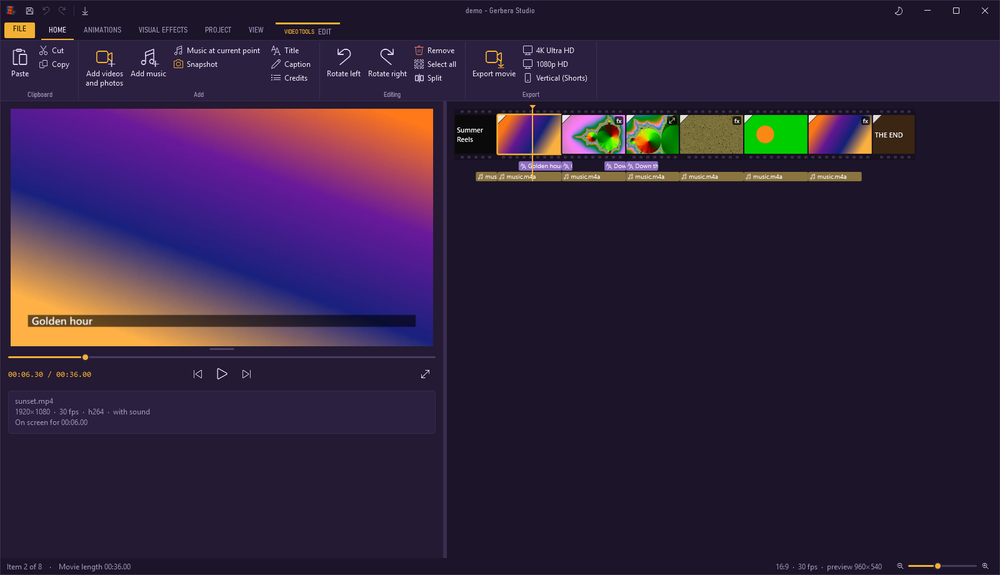 | 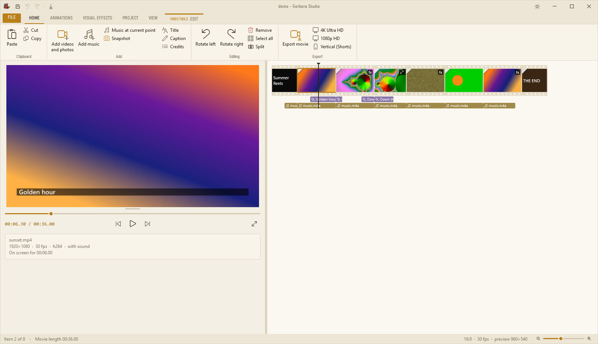 |
| **Midnight**: black cinema | **Evening**: dusky purple | **Morning**: warm paper |

### Editing tools
| | |
|---|---|
| 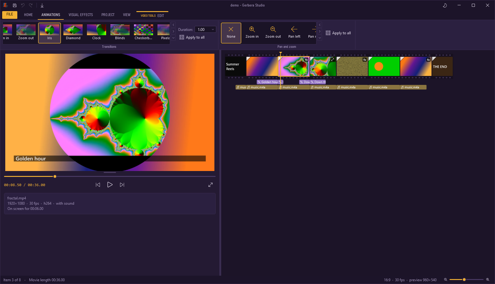 | 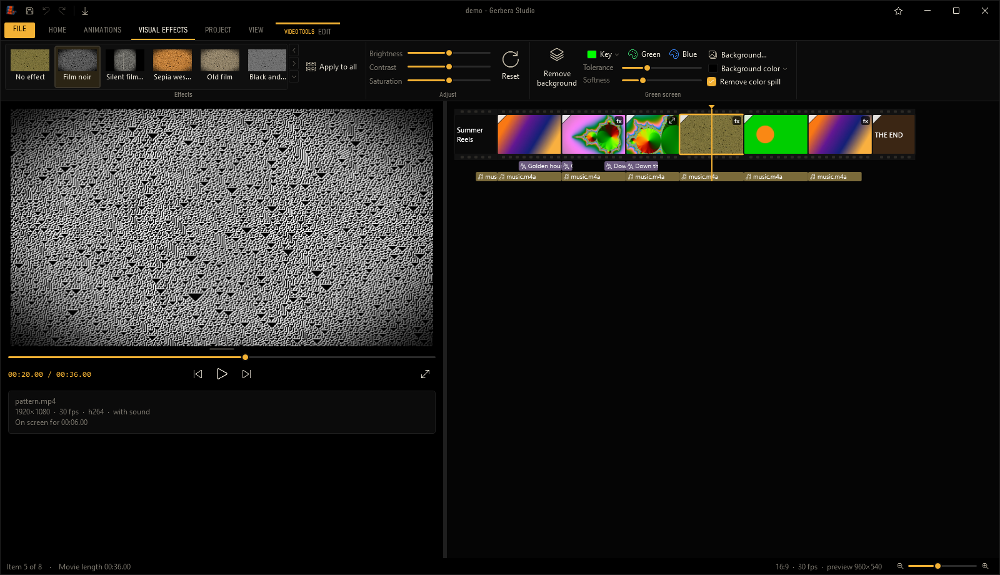 |
| **Animations:** 25 transitions (here, Iris mid-wipe) plus pan and zoom | **Visual Effects:** Film noir, with brightness, contrast and saturation |
| 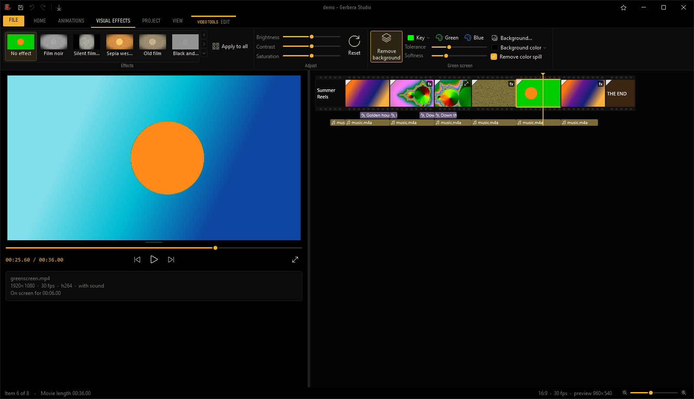 | 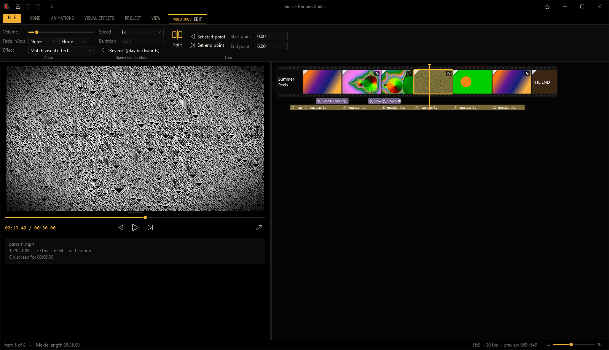 |
| **Green screen:** the subject keyed over a background image | **Edit:** volume, fades, audio effects ("Match visual effect"), speed, **reverse** and trimming |
| 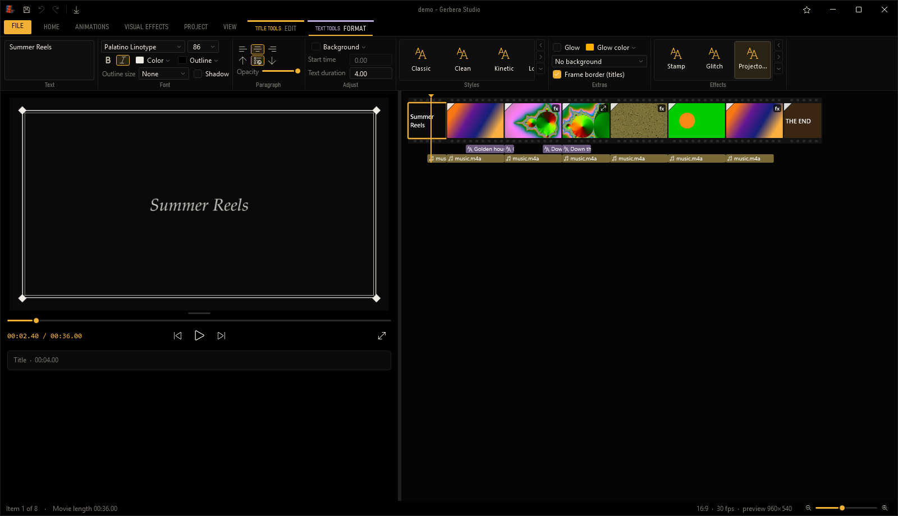 | 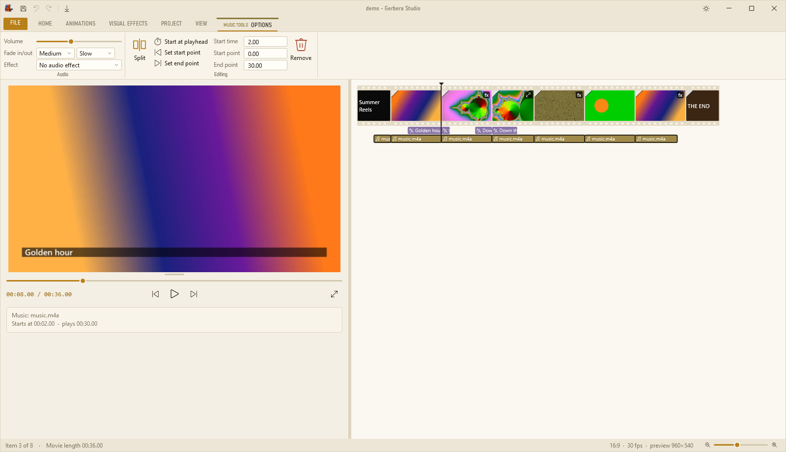 |
| **Text:** style presets, like this silent-film title card with an ornate frame | **Music:** volume, fades, audio effects, start time and trimming |
| 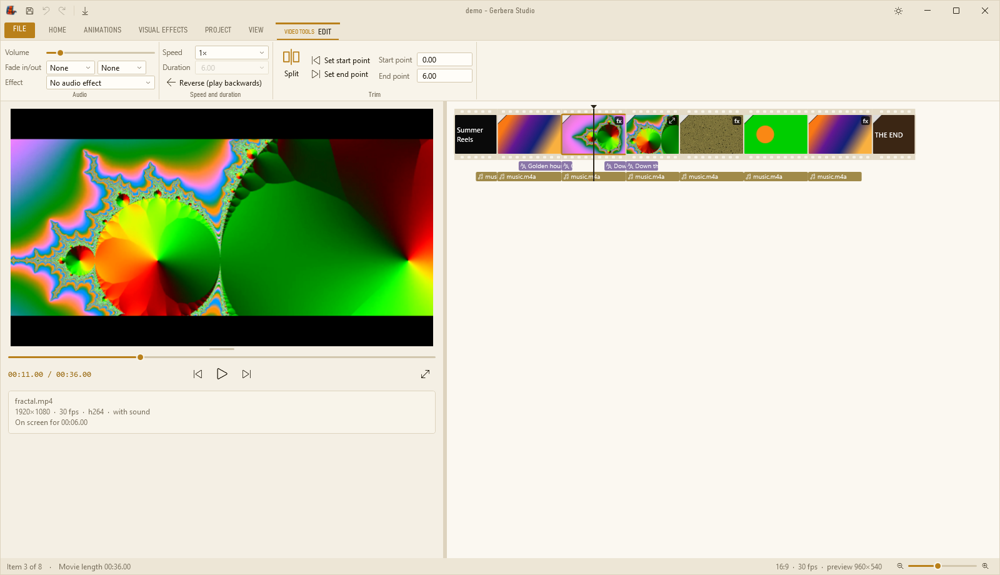 | 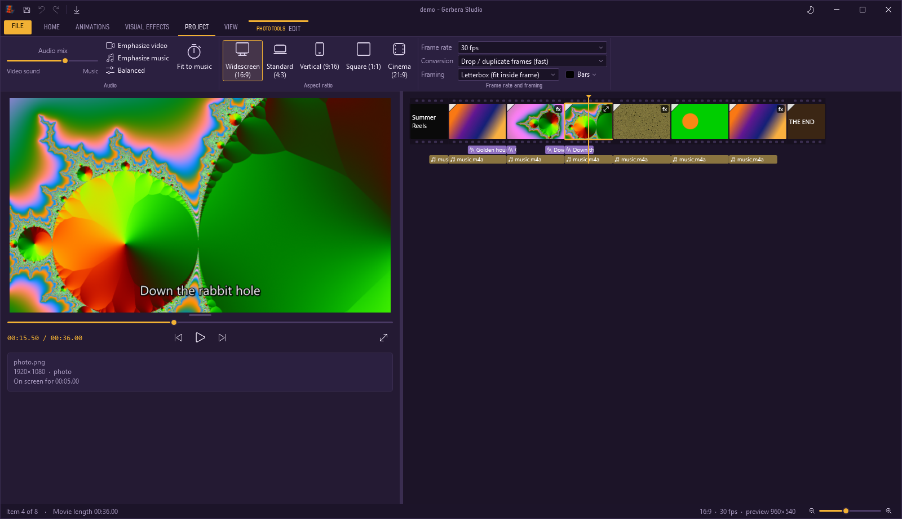 |
| **Split:** a dedicated icon (two frames and a cut line), here on the Edit tab in Morning | **Project:** audio mix, aspect ratios, frame rate and framing |
| 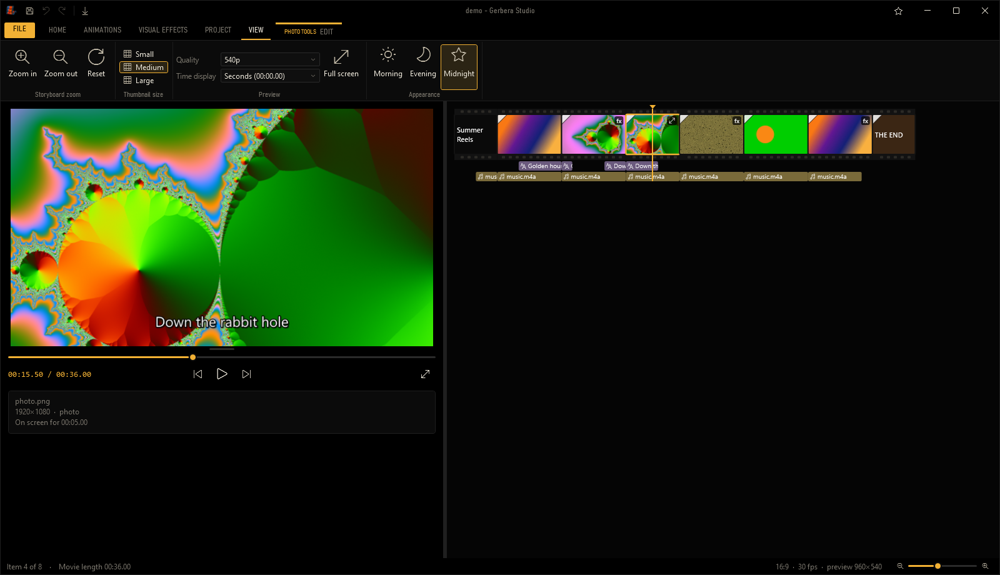 | |
| **View:** storyboard zoom, thumbnail size, preview quality and themes | |
| 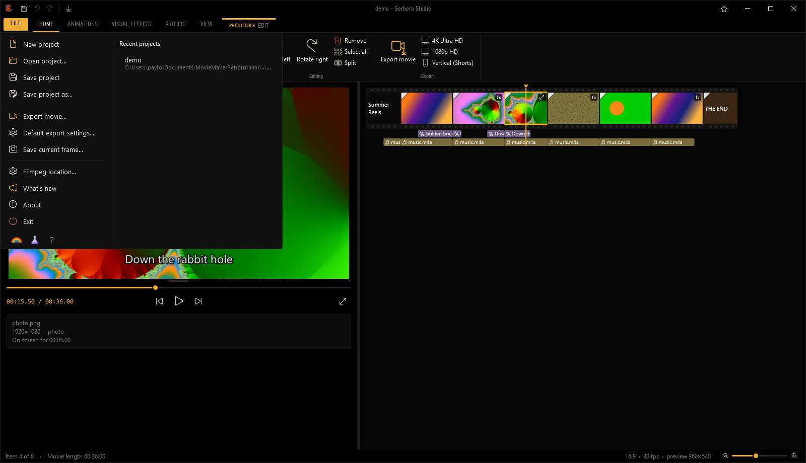 | 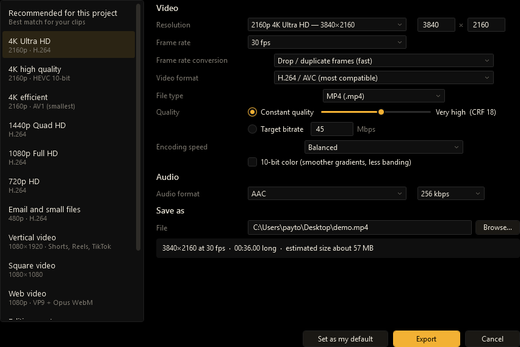 |
| **File menu:** recent projects, What's new, the Labs beaker and a little rainbow | **Export movie:** presets up to 8K, modern formats, GPU encoding and your own default |

---|---|
|  |  |
| **Midnight** | **Evening** |
|  |  |
| **Morning** | **Visual effects** |
|  |  |
| **Green screen** | **Silent-film title card** |
|  | |
| **Export movie** | |

---

## What's new in 1.1

**Gerbera Labs** (with an optional nostalgic loading screen), default export settings, a clearer **Export** button, a new Split icon, and a green-screen fix. See the [changelog](CHANGELOG.md).

---

## Gerbera Labs and the nostalgic loading screen

Click the **beaker** next to the rainbow in the **File** menu to open **Labs**, a home for experimental and just-for-fun extras. It bubbles when you open it.

| | |
|---|---|
| 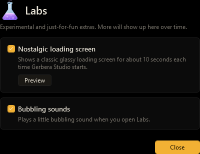 | 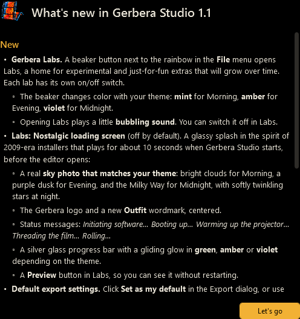 |
| **Labs:** switch extras on and off. The beaker matches your theme. | **What's new:** shown once after each update, or anytime from **File ▸ What's new** |

The first lab is a **nostalgic loading screen**, a glassy splash in the spirit of 2009-era installers, with a sky that matches your theme:

| Midnight | Evening | Morning |
|---|---|---|
| 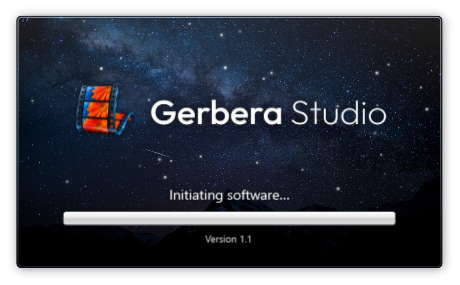 | 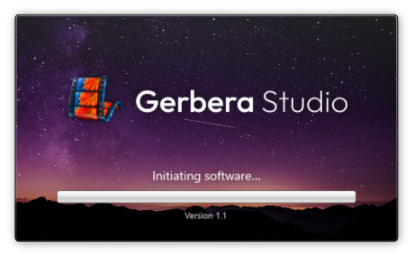 | 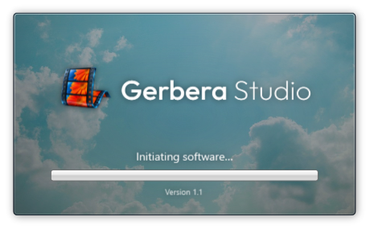 |

---

## Getting started

### 1. Install
1. Download **GerberaStudio-Setup-1.1.exe** from the [latest release](../../releases/latest).
2. Run it. Windows SmartScreen may say *"Windows protected your PC"* because the installer isn't code-signed (signing certificates are expensive for a free hobby project). Click **More info ▸ Run anyway**.
3. On first launch, Gerbera Studio offers to **download FFmpeg** automatically (about 140 MB, once). FFmpeg is the open-source engine that reads and writes video.

**Requirements:** 64-bit Windows 10 or 11. A graphics card isn't required, but makes exporting much faster.

### 2. Make your first movie
1. **Add your clips:** click the storyboard area, or **Home ▸ Add videos and photos**, or drag files in from File Explorer.
2. **Arrange them:** drag tiles to reorder. Click a tile to jump the preview to it.
3. **Trim:** play to where you want a clip to start and click **Edit ▸ Set start point** (or press **I**). Do the same for the end (**O**). Press **M** to split a clip in two.
4. **Add transitions:** select a clip, open **Animations**, and pick one from the gallery. Hover to preview it.
5. **Add a look:** open **Visual Effects** and pick an effect, or adjust brightness and contrast.
6. **Add music:** **Home ▸ Add music**. Use the **Project** tab's audio mix slider to balance it against your clips' sound.
7. **Add a title or captions:** **Home ▸ Title / Caption / Credits**, then type in the **Text** tab and try a **Style**.
8. **Export your movie:** **Home ▸ Export movie**, choose a preset like **4K Ultra HD**, and click **Export**. Tip: click **Set as my default** to remember your favorite settings.

Also save your **project** (**Ctrl+S**) so you can come back and keep editing. Project files end in `.mmrproj`.

### 3. Using green screen
1. Select a clip filmed against a green (or blue) background.
2. **Visual Effects ▸ Green screen ▸ Remove background color**.
3. Click **Background…** to choose a photo or video to go behind your subject.
4. Nudge **Tolerance** until the background disappears, raise **Softness** for smoother edges, and keep **Remove color spill** ticked to clean up green fringes.

### 4. Pairing sound with a look
1. Give a clip the **Film noir**, **Silent film 1:1**, **Sepia western** or **VHS tape** effect.
2. Open **Edit ▸ Audio ▸ Effect** and choose **Match visual effect**. The sound now degrades to match the picture.
3. Prefer a different combination? Pick any audio effect directly. They're fully independent.

---

## Keyboard shortcuts

| Key | Action |
|---|---|
| **Space** | Play / pause |
| **← / →** | Previous / next frame (**Shift**: 1 second, **Ctrl**: previous / next clip) |
| **Home / End** | Jump to start / end |
| **M** | Split at the playhead |
| **I / O** | Set start / end point |
| **Delete** | Remove |
| **Ctrl+Z / Ctrl+Y** | Undo / redo |
| **Ctrl+X / C / V** | Cut / copy / paste |
| **Ctrl+I** | Add videos and photos |
| **Ctrl+T** | Add a title |
| **Ctrl+S** | Save project |
| **Ctrl+E** | Export movie |
| **F11** | Full-screen preview |
| **+ / −** | Zoom the storyboard |

---

## Building from source

Gerbera Studio is written in **C# / WPF (.NET 8)** and uses **FFmpeg** for decoding and encoding.

1. Install the [.NET 8 SDK](https://dotnet.microsoft.com/download/dotnet/8.0) (x64).
2. Clone this repo and run **`src\build.bat`**. It produces a self-contained `src\out\GerberaStudio.exe`.
3. *(Optional)* Install [Inno Setup](https://jrsoftware.org/isdl.php) and run **`src\make-installer.bat`** to produce `src\installer\GerberaStudio-Setup-1.1.exe`.

### How it works
- **`Engine/`**: FFmpeg-based decoders stream frames for each clip. A compositor renders transitions, effects, green screen, pan and zoom, and text. The audio graph builder mixes sound and effects through FFmpeg filters, and the exporter pipes rendered frames into the encoder.
- **`Views/`**: the custom storyboard, galleries, Export dialog and progress window.
- **`Themes/`**: the Morning, Evening and Midnight color sets and the control styles.

---

## Thank you

A huge thank-you to **Larry, Bruce, Mom, Dad and Lily**. I couldn't have done this without you all. ❤️ (There's a little rainbow in the File menu.)

---

## Credits

Loading-screen sky photos from [Unsplash](https://unsplash.com):
- **Morning:** [Clyde RS](https://unsplash.com/@imclyde)
- **Evening:** [Vincentiu Solomon](https://unsplash.com/@vincentiu)
- **Midnight:** Phil Botha

The wordmark on the loading screen uses [Outfit](https://fonts.google.com/specimen/Outfit), licensed under the SIL Open Font License.

---

## License and disclaimer

Gerbera Studio's source code is released under the [MIT License](LICENSE).

Gerbera Studio is an independent fan project and a love letter to the classic Windows movie editor. It is **not affiliated with, endorsed by, or connected to Microsoft**. *Windows* and *Windows Movie Maker* are trademarks of Microsoft Corporation.

Gerbera Studio uses [FFmpeg](https://ffmpeg.org), which it downloads separately on first launch. FFmpeg is licensed under the LGPL/GPL by its respective authors.
